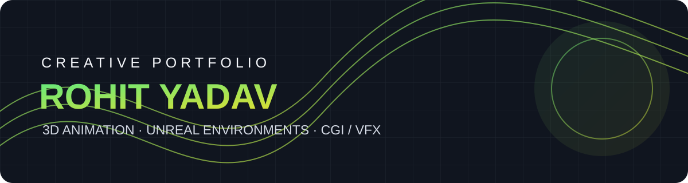
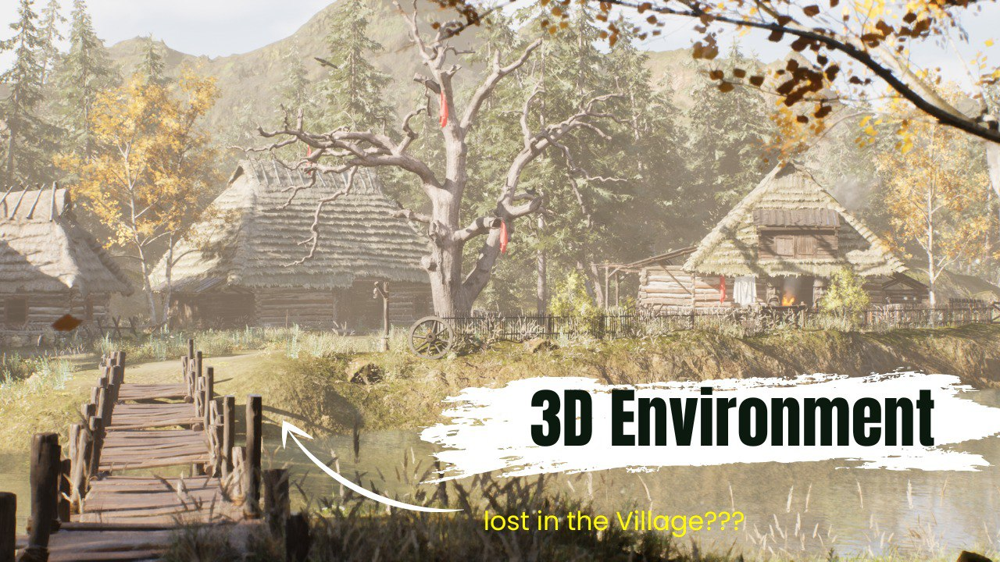
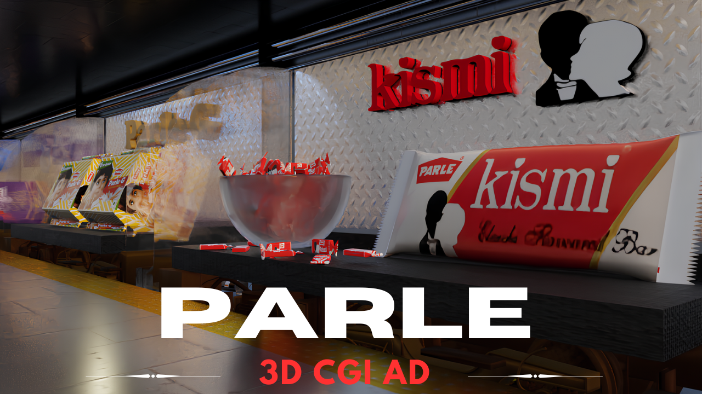

# Rohit Yadav | 3D Animation, CGI & Unreal Environment Art

Welcome to my creative portfolio repository. I'm a **3D Animator and Unreal Environment Artist** with **4+ years of industry experience**, focused on product animation, cinematic environments, realistic CGI, short-film animation, and high-end visual effects.

- **Portfolio:** https://rohitcreative.github.io/Portfolio/
- **ArtStation / Showreel:** https://www.artstation.com/rohitcreative
- **LinkedIn:** https://www.linkedin.com/in/rohit-creative
- **YouTube:** https://www.youtube.com/@DesignerxArtist

## Featured projects

<table>
  <tr>
    <td width="50%">
      
      <h3>Greenhaven Hollow</h3>
      A cinematic fantasy village environment focused on atmosphere, composition, lighting, and environmental storytelling.
    </td>
    <td width="50%">
      
      <h3>Shadow Over the Bridge</h3>
      A desert military-action cinematic environment built around a bridge, helicopters, and dramatic visual storytelling.
    </td>
  </tr>
  <tr>
    <td width="50%">
      
      <h3>Feel the Rush of Pure Motion</h3>
      Automotive animation exploring product presentation, motion, camera work, and cinematic lighting.
    </td>
    <td width="50%">
      
      <h3>Product CGI & Advertising</h3>
      Product-focused CGI and advertising visuals designed to present brands with polished, photorealistic imagery.
    </td>
  </tr>
</table>

## Skills & tools

- **3D / Real-time:** Blender, Unreal Engine
- **Animation / VFX:** Product animation, cinematic camera animation, short-film animation, CGI, compositing, visual effects
- **Creative suite:** Adobe Premiere Pro, After Effects, Photoshop, Illustrator
- **Focus areas:** Environment art, lighting, visual storytelling, realistic rendering, production workflows

## Recognition

I have received recognition for environment-art projects, including the **Creative Mind award**. Selected award documentation is available in this repository:

## About this repository

This repository hosts my portfolio website and selected project visuals. The live website is published with GitHub Pages:

**https://rohitcreative.github.io/Portfolio/**

Thanks for visiting. For collaborations, freelance enquiries, or professional opportunities, please reach out through LinkedIn or my portfolio.
